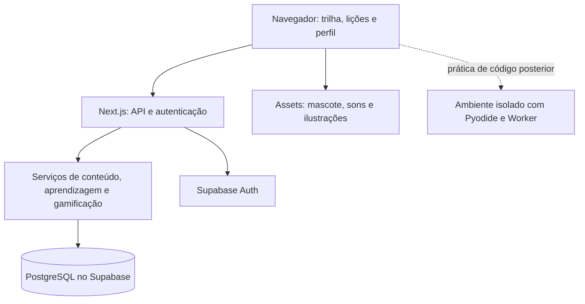

# Plano de produto e arquitetura — aprendizagem de Python com experiência semelhante ao Duolingo

Data: 7 de outubro de 2026. Documento de planejamento; nenhuma implementação faz parte desta entrega.

Para acompanhar a execução, usar o [checklist operacional da seção 19](#19-checklist-operacional). As seções anteriores explicam as decisões; o checklist organiza tarefas, dependências e critérios para marcar a conclusão.

## 1. Direção e premissas

Criar uma aplicação web responsiva, em português brasileiro, para iniciantes aprenderem Python em sessões de 5 a 10 minutos. A experiência central terá trilha vertical, lições em botões circulares, mascote, corações, XP, sequência diária, cristais e telas de celebração.

Premissas de planejamento: equipe pequena, um desenvolvedor principal, primeira turma pequena para validação, público inicial adulto iniciante, conectividade durante as lições e ausência de monetização no primeiro lançamento. O público ainda pode ser ajustado; crianças exigiriam outra revisão de linguagem, contas e experiência.

A aparência e as interações devem se aproximar bastante da referência solicitada. Nome, mascote, ilustrações, sons e textos serão próprios. O mascote proposto é uma cobrinha, com estados de incentivo, comemoração, atenção e descanso.

Decisão principal: monólito modular em Next.js e TypeScript, PostgreSQL e autenticação no Supabase, hospedagem inicialmente na Vercel. Python será a linguagem ensinada e, posteriormente, executada no navegador.

## 2. Experiência e telas

| Tela | Conteúdo e comportamento |
| --- | --- |
| Apresentação | Mascote, benefício direto e botão Começar; demonstração sem conta |
| Introdução | Nome, meta diária e explicação curta da trilha |
| Aprender | Trilha sinuosa, unidades, lição atual e pontos de revisão; baús na segunda entrega |
| Lição | Um exercício por tela, progresso, corações, Verificar e Continuar |
| Resultado | XP confirmado, desempenho, sequência e próxima ação |
| Praticar | Revisões recomendadas e recuperação de corações |
| Perfil | Progresso, conquistas, meta, preferências e fuso horário |
| Acesso | Cadastro, login, recuperação de acesso e saída |
| Ranking — posterior | Ligas semanais e posição do aluno |
| Loja — posterior | Gastos de cristais e itens cosméticos |
| Administração — posterior | Autoria, revisão, prévia e publicação de conteúdo |

No desktop, usar menu à esquerda, trilha central e painel de metas à direita. No celular, usar uma coluna, indicadores no topo e navegação inferior. Durante a lição, apresentar uma interface dedicada ao exercício.

Criar componentes visuais para botões com profundidade, cartões, bolinhas de trilha, indicadores, balões do mascote, progresso, feedback e celebração. Estados de carregamento, erro, falta de conexão e retomada fazem parte do desenho.

Som deve poder ser desligado; animações devem respeitar redução de movimento. Navegação por teclado e alternativas ao arrastar blocos são necessárias. Feedback precisa de texto e ícone, além de cor. Validar também a interação com teclado virtual no celular.

## 3. Escopo de entrega

### MVP

Três unidades com cinco lições cada, entre cinco e oito exercícios por lição. Planejar aproximadamente 105 exercícios principais e 30 a 45 variações de revisão. Criar cadastro, progresso persistente, trilha, quatro tipos de exercício, dicas, XP, corações, sequência, três conquistas e recuperação de sessão. Cristais, baús e lembretes ficam fora do MVP; o inventário completo está na [especificação do MVP](ESPECIFICACAO_MVP.md#2-inventário-de-funcionalidades-do-mvp).

Tipos iniciais: escolher resultado, completar lacuna com opções, ordenar blocos por toque ou teclado e localizar erro. A seleção de blocos funciona sem exigir um editor completo. O desafio final combina os conceitos em um programa montado por etapas.

Uma demonstração anônima terá uma lição fixa e progresso local. Ao criar conta, oferecer a transferência desse resultado, revalidando no servidor as respostas enviadas e concedendo a recompensa uma única vez. Enquanto não houver conta, apresentar XP como provisório.

### Segunda entrega

Editor com Python no navegador, unidades sobre entrada de dados, laços, listas e funções, projetos curtos, cristais, baús, loja, proteção de sequência e missões diárias. O editor será liberado após a validação técnica de desempenho e isolamento.

### Terceira entrega

Ligas semanais, painel de autoria, notificações opcionais e instalação como PWA. Ensino offline, assinatura, tutor por IA e correção remota de código são decisões futuras, condicionadas aos resultados de uso.

## 4. Stack recomendada

| Camada | Escolha | Motivo |
| --- | --- | --- |
| Aplicação | Next.js, React e TypeScript | Interface e servidor no mesmo projeto; tipos compartilhados |
| Estilo | Tailwind CSS e componentes próprios | Controle sobre a aparência desejada |
| Animações iniciais | CSS e SVG | Estados pequenos, fáceis de controlar e desativar |
| API | Route Handlers do Next.js | Contratos explícitos para sessões e respostas |
| Validação | Zod | Validar requisições e conteúdo estruturado |
| Banco | PostgreSQL no Supabase | Relações, transações e restrições de integridade |
| Autenticação | Supabase Auth | Cadastro e sessões integradas ao servidor |
| Acesso ao banco | Drizzle ORM | Esquema tipado e migrações SQL versionadas |
| Arquivos | Assets estáticos; Supabase Storage quando houver uploads | Separar conteúdo visual de dados de progresso |
| Hospedagem | Vercel | Caminho inicial integrado ao Next.js |
| Testes | Vitest e Playwright | Regras de domínio e jornadas no navegador |
| Editor posterior | CodeMirror | Editor configurável no navegador |
| Python posterior | Pyodide em Web Worker | Executar Python fora da thread da interface |

Usar versões estáveis compatíveis e fixadas no momento da implementação, runtime Node.js suportado e lockfile no repositório. A consulta atual às documentações fundamenta as escolhas, mas o plano não fixa números de versão.

Next.js suporta componentes de servidor e de cliente: reservar os componentes interativos para trilha dinâmica e exercícios, aproveitando o servidor para leituras e renderização inicial. [Documentação do Next.js](https://nextjs.org/docs/app/getting-started/server-and-client-components).

Next.js também oferece Route Handlers para atuar como backend da interface. Leituras feitas por componentes de servidor devem chamar os serviços internos diretamente, evitando uma chamada HTTP ao próprio aplicativo. [Backend for Frontend](https://nextjs.org/docs/app/guides/backend-for-frontend).

Supabase fornece autenticação integrada a renderização no servidor e PostgreSQL; Drizzle tem integração documentada com o banco do Supabase e migrações. [Supabase Auth](https://supabase.com/docs/guides/auth/server-side), [Drizzle e Supabase](https://orm.drizzle.team/docs/tutorials/drizzle-with-supabase).

Tailwind possui integração documentada com Next.js; Zod permite validar dados com esquemas TypeScript. [Tailwind](https://tailwindcss.com/docs/installation/framework-guides/nextjs), [Zod](https://zod.dev/basics).

Um backend separado em Django ou FastAPI seria uma alternativa válida para uma equipe que já domina Python. Neste cenário, a recomendação por Next.js prioriza a interface intensamente interativa e um único projeto para operar. Ensinar Python não determina a linguagem do backend.

## 5. Arquitetura

Um repositório e uma aplicação implantável, com módulos de identidade, conteúdo, aprendizagem, gamificação e relatórios. Cada módulo terá interface, serviço de domínio, validação e persistência conforme necessário. As rotas HTTP coordenam operações; as regras de negócio ficam nos serviços.

Conteúdo público pode usar cache. Respostas corretas, progresso, moedas e dados pessoais ficam protegidos. Dados específicos de um aluno não devem entrar em cache compartilhado.

O navegador envia identificadores e respostas. O servidor identifica o aluno, valida a resposta e calcula os efeitos. XP, cristais, corações e desbloqueios sempre derivam do estado persistido pelo servidor.

Inicialmente, o estado temporário da lição pode usar um reducer local. Não é necessário introduzir uma biblioteca global de estado. O servidor permanece a referência para tudo que deve sobreviver a recargas e mudanças de dispositivo.

## 6. Conteúdo e motor de exercícios

| Unidade inicial | Conteúdo | Desafio final |
| --- | --- | --- |
| 1 — Primeiros comandos | Saída, valores e variáveis | Montar um cartão de apresentação |
| 2 — Valores e operações | Tipos básicos, números, strings e operadores | Montar um cálculo com mensagem |
| 3 — Decisões | Booleanos, comparações e if/else | Montar um verificador de condição |

Cada exercício deve definir: identificador estável, versão, tipo, objetivo pedagógico, conceitos envolvidos, enunciado, trecho de código, opções ou blocos, regra de correção, explicação, dicas graduais e dificuldade.

Separar o conteúdo mostrado ao aluno do gabarito reservado ao servidor. Cada tipo terá um componente de apresentação e um corretor próprio. Para exercícios objetivos, a correção será determinística: alternativa correta, preenchimento por opção, ordem válida ou identificação da linha.

Definir estados explícitos da lição: carregando, respondendo, verificando, feedback, próxima questão, concluindo, concluída e pausada. Isso evita que duas submissões ou uma recarga desorganizem a sessão.

Os erros devem voltar ao final da sessão até que sejam resolvidos. Preservar o desempenho da primeira resposta, mesmo após a correção. Dicas também ficam registradas para orientar revisões.

Uma lição concluída requer resolução de todos os exercícios previstos. Reabrir uma lição concluída cria uma sessão de prática, sem conceder novamente a recompensa de primeira conclusão.

A revisão inicial usa agenda simples: repetir conceitos após cerca de 1, 3 e 7 dias, ajustando conforme acertos e dicas. Esses intervalos são hipóteses de produto a testar. No início, mostrar estados como iniciado, praticando e consolidando; não afirmar domínio com base em poucas respostas.

## 7. Modelo de dados

| Grupo | Entidades propostas |
| --- | --- |
| Identidade | Perfis e preferências vinculados ao identificador do Supabase Auth |
| Curso | Cursos, unidades e lições |
| Conteúdo | Versões publicadas, exercícios, conceitos e gabaritos privados |
| Aprendizagem | Sessões de lição, itens da sessão, submissões e conclusões |
| Revisão | Estado do aluno por conceito e próximo prazo de revisão |
| Gamificação | Estado de corações, lançamentos de recompensas e conquistas |
| Atividade | Atividade diária por aluno e data local |
| Operação | Eventos de produto mínimos e registros de erro sem respostas pessoais |

Histórico de recompensas será um livro de lançamentos: causa, valor, usuário e identificador único do evento. Totais de XP e cristais podem ser armazenados como projeções atualizadas na mesma transação.

Restrições importantes: uma recompensa inicial por aluno e lição; um processamento por identificador de submissão; uma conquista por aluno; uma atividade diária por aluno e data; saldo de corações entre zero e cinco.

Conclusão, recompensa, desbloqueio e atualização da atividade diária devem ocorrer na mesma transação. Concorrência entre duas abas exige proteção no banco, além de desabilitar botões na interface.

Sessões iniciadas ficam vinculadas à versão de conteúdo usada no início. Publicar uma correção não pode trocar o gabarito de uma sessão em andamento.

## 8. Regras de gamificação propostas

Os valores abaixo são parâmetros iniciais, ajustáveis após o beta.

| Mecânica | Regra inicial |
| --- | --- |
| XP de primeira conclusão | 20 XP por lição |
| XP de prática | 10 XP por sessão elegível; até três sessões recompensadas por dia |
| Prática adicional | Permitida sem recompensa de XP |
| Corações | Cinco; perder um na primeira resposta incorreta de cada item da sessão principal |
| Repetição do erro | Corrigir o mesmo item não consome corações adicionais |
| Zero corações | Pausar a trilha; manter a sessão e oferecer revisão |
| Recuperação | Revisão de cinco itens, sem perda de corações, devolve dois até o limite de cinco |
| Sequência | Uma sessão elegível concluída no dia mantém ou inicia a sequência |
| Meta diária | Uma, duas ou três sessões; indicador separado da sequência |
| Cristais — segunda entrega | Com a loja: cinco na primeira conclusão; baús concedidos uma vez no percurso |
| Conquistas iniciais | Primeira lição, primeira unidade e sete dias de sequência |
| Desbloqueio | Próxima lição após a conclusão da anterior |

Cristais e baús chegam com a loja, na segunda entrega; o MVP não tem moeda. Nenhuma compra ou pagamento faz parte do lançamento inicial. Prática de código livre, quando adicionada, não terá recompensa competitiva baseada somente no resultado informado pelo navegador.

Guardar horários em UTC e calcular o dia de estudo usando o fuso IANA da conta. A sugestão inicial vem do navegador e deve ser confirmável nas preferências. Mudanças de fuso precisam de política explícita para impedir dois créditos para a mesma atividade; a aplicação da mudança começa no próximo dia de estudo.

Corações não desaparecem por falha de rede, recarga ou erro de servidor. Uma submissão reenviada devolve o resultado persistido, sem descontar novamente. A recuperação de corações continua disponível mesmo depois de atingir o limite diário de XP de prática.

## 9. Contratos e fluxo de uma lição

Operações principais: carregar trilha, iniciar ou retomar sessão, obter exercício atual, submeter resposta, solicitar dica, concluir sessão, iniciar revisão e consultar perfil.

Cada submissão terá identificador próprio, sessão, item, versão e resposta. O servidor verifica a sessão autenticada e a propriedade dos dados. IDs do navegador não concedem acesso por si mesmos.

Fluxo de conclusão: validar todos os itens; registrar conclusão se ainda não existe; conceder recompensa; atualizar atividade e estado da trilha; confirmar resultado; só então mostrar XP como efetivamente recebido.

Em falha de conexão, preservar a resposta temporária e permitir reenvio com o mesmo identificador. Não avançar definitivamente sem confirmação. Uma recarga recupera o último exercício confirmado. O aluno pode retomar a sessão em outro dispositivo.

Exercícios objetivos não precisam executar Python para serem corrigidos. Isso permite validar a jornada principal antes de disponibilizar um ambiente de execução.

## 10. Execução de Python posterior

Usar CodeMirror para edição e Pyodide em Web Worker para executar Python no navegador. Carregar o runtime somente quando a pessoa abrir um exercício de código. Preparar entrada e saída em um painel próprio. [CodeMirror](https://codemirror.net/docs/guide/), [Pyodide em Worker](https://pyodide.org/en/stable/usage/webworker.html).

O Worker mantém o código fora da thread da interface, mas não é, sozinho, uma barreira de segurança contra código arbitrário. Planejar uma origem de execução separada, sem cookies da aplicação, com política de rede restritiva e comunicação por mensagens validadas. Nenhum segredo ou token deve ser enviado a esse ambiente.

O protótipo técnico precisa verificar carregamento em celulares, loop infinito, cancelamento, excesso de saída, reset entre execuções, entrada de dados, acesso ao ambiente JavaScript e limites de rede. Definir inicialmente orçamento de execução de três segundos e saída truncada. Encerrar e recriar o Worker em timeout; o orçamento é configurável. Não prometer um limite rígido de memória em todas as plataformas. [Encerramento de Worker](https://developer.mozilla.org/en-US/docs/Web/API/Worker/terminate).

Respostas produzidas no navegador são manipuláveis. Testes locais servem para feedback de prática e não constituem prova confiável para ranking ou certificação. O MVP usa correção autoritativa de respostas objetivas no servidor.

Se a futura trilha exigir aprovação confiável de código arbitrário, será necessário um executor remoto isolado com CPU, memória, tempo, saída e rede limitados. Esse executor ficará separado do servidor web, com fila e testes privados. FastAPI poderá coordenar esse serviço, mas o framework não substitui a sandbox.

## 11. Autenticação, acesso e integridade

Implementar login por e-mail e senha, verificação de e-mail e recuperação de acesso. Sessões devem seguir a integração de servidor documentada pelo Supabase. O login social é opcional posterior.

Operações de progresso usam o servidor e conexões ao banco com permissões definidas. Quando houver tabelas expostas pela API do Supabase, aplicar RLS e políticas apropriadas. Uma conexão de backend privilegiada pode ignorar RLS; portanto, os serviços devem validar propriedade e autorização explicitamente. Manter gabaritos em área privada, sem acesso público. [RLS do Supabase](https://supabase.com/docs/guides/database/postgres/row-level-security).

Usar limitação de frequência em endpoints de resposta e autenticação, validação de origem para operações baseadas em cookies e limites de tamanho das entradas. Separar privilégios de aluno e administração. Segredos permanecem no servidor.

Para o MVP, coletar apenas dados necessários para conta e progresso. Planejar exclusão de conta e dados e exportação do histórico pessoal. O ranking futuro usa apelido, sem exibir e-mail.

## 12. Conteúdo como processo de produção

Inicialmente, autoria em arquivos estruturados versionados no repositório, validados por esquema e importados para o banco por uma etapa explícita de publicação. Mudanças de conteúdo passam por revisão de enunciado, corretor e explicação.

O esquema do banco terá uma única cadeia de migrações controlada pelo Drizzle. Evitar duas ferramentas aplicando alterações independentes nas mesmas tabelas. Conteúdo e esquema são processos separados.

Antes de publicar uma unidade, conferir que exemplos executam na versão de Python escolhida, respostas são inequívocas, distratores representam erros plausíveis e exercícios de revisão variam o contexto. Exercícios de blocos devem aceitar ordens alternativas quando forem semanticamente válidas, ou restringir o enunciado para tornar a ordem única.

O painel administrativo posterior terá rascunho, prévia, revisão e publicação, mantendo identificadores e versões estáveis.

## 13. Hospedagem e operação

Três ambientes: desenvolvimento, homologação e produção. O beta pode usar homologação isolada; ao abrir acesso público, separar efetivamente os bancos. Previews não podem usar dados de produção.

Vercel recebe a aplicação Next.js; Supabase fornece Auth e PostgreSQL. Escolher regiões próximas entre si e apropriadas ao público, conforme disponibilidade. Usar o modo de conexão/pool adequado ao ambiente de funções e uma conexão apropriada para migrações. [Next.js na Vercel](https://vercel.com/docs/frameworks/full-stack/nextjs), [Conexões PostgreSQL no Supabase](https://supabase.com/docs/guides/database/connecting-to-postgres).

Preparar pipeline com validação de conteúdo, tipos, lint, testes relevantes e build. Migrações têm revisão e execução controlada. Usar alterações compatíveis com a versão anterior quando possível, para permitir retorno do aplicativo.

Manter registros de erro, correlação por requisição, monitoramento de submissões e alertas para falhas de conclusão. Evitar respostas, senhas, e-mails e código pessoal nos logs. Configurar backup, retenção e um exercício de restauração conforme os recursos contratados.

Custos devem ser levantados antes do beta: hospedagem, banco, autenticação, envio de e-mails, armazenamento, tráfego de assets e observabilidade. Não assumir que planos gratuitos atendem à operação pública. Para Pyodide, incluir tráfego do runtime; para correção remota posterior, considerar custo por execução e controle de abuso.

## 14. Etapas e estimativa

Estimativa de planejamento para um desenvolvedor experiente em dedicação consistente: cerca de 8 a 12 semanas até um MVP validado. Ilustração, autoria, disponibilidade e familiaridade com a stack podem alterar bastante esse prazo. As faixas abaixo não são uma soma rígida; revisão de conteúdo e design podem acompanhar as etapas técnicas.

| Etapa | Entrega | Faixa indicativa | Critério de saída |
| --- | --- | --- | --- |
| 1 — Especificação | Regras, fluxos, inventário de telas e primeira unidade detalhada | 3–5 dias | Escopo e critérios inequívocos |
| 2 — Design | Trilha desktop/mobile, exercício, resultado e estados de erro em protótipo | 5–8 dias | Usuários conseguem seguir a jornada sem explicação |
| 3 — Base | Projeto, acesso, banco, migrações, ambientes e uma sessão persistente | 4–6 dias | Conta criada e sessão recuperável |
| 4 — Motor | Quatro tipos, correção, dicas, feedback e retomada | 7–10 dias | Uma lição completa funciona com recarga e reenvio |
| 5 — Gamificação | XP, corações, revisão, sequência, conquistas e desbloqueio | 5–8 dias | Sem recompensa ou perda duplicada |
| 6 — Conteúdo | Quinze lições e banco de revisão revisados | 7–12 dias | Curso completo sem bloqueios de conteúdo |
| 7 — Beta | Testes de uso, ajustes, performance e operação | 5–8 dias | Critérios de lançamento atendidos |

Prioridade técnica: finalizar uma jornada vertical com uma lição antes de ampliar para quinze. Essa jornada precisa cobrir apresentação, acesso, exercício, correção, persistência, recompensa e desbloqueio.

A execução no navegador merece um experimento técnico posterior de 2 a 4 dias antes de estimar a segunda entrega. Se o isolamento ou desempenho não atenderem aos critérios, manter o editor fora do lançamento e definir outra solução com base nos resultados.

## 15. Testes e critérios de lançamento

Testes de domínio: regras de recompensa, corações, elegibilidade de prática, desbloqueio e datas locais. Testes de integração: transações, sessão pertencente a outro aluno, envio duplicado, concorrência entre abas e versões de conteúdo. Testes de jornada: cadastro, lição, retomada, zero corações, revisão e resultado.

Vitest cobre regras e serviços; Playwright cobre os fluxos em navegadores, com validação manual em aparelhos reais para teclado virtual e desempenho. [Vitest](https://vitest.dev/guide/), [Playwright](https://playwright.dev/docs/intro).

O MVP estará pronto quando: as quinze lições forem completáveis; não houver XP ou desconto duplicado; recarga e falha de rede preservarem a sessão; outro usuário não conseguir acessar o progresso; o fluxo funcionar em celular e desktop; existir acesso por teclado e controle de som; dados de produção estiverem separados; houver capacidade de diagnóstico e recuperação.

Não exigir metas de tráfego inventadas antes do beta. Medir latência real de correção e carregamento no público inicial para definir limites operacionais. A meta inicial de UX é que a transição entre exercícios não dependa de recarregar a página.

## 16. Avaliação do produto

Eventos mínimos: demonstração iniciada, conta criada, lição iniciada, exercício respondido, dica pedida, sessão retomada, lição concluída e revisão concluída. Usar identificadores de conceito e exercício sem guardar dados pessoais desnecessários na análise.

Medir ativação pela primeira lição concluída, retorno em 1 e 7 dias, abandono por exercício, frequência de revisão, resolução sem dicas e conclusão de unidade. A análise de aprendizagem usa o primeiro acerto em exercícios novos; acertar depois de ver a solução não tem a mesma interpretação.

Convidar 10 a 20 iniciantes para uma primeira rodada. Observar se encontram a próxima lição, entendem o feedback, recuperam corações e conseguem resolver uma variação sem ajuda. Definir metas numéricas após essa linha de base.

## 17. Riscos e resposta planejada

| Risco | Resposta |
| --- | --- |
| Interface agradável com pouco aprendizado | Variar questões, preservar primeiro desempenho e incluir transferência para desafios |
| Corretor rígido demais | Revisar alternativas válidas e explicar os requisitos |
| Corações interrompem demais | Recuperação simples e ajuste baseado no beta |
| Conteúdo consome mais tempo que previsto | Produzir a primeira unidade completa antes de estimar o restante |
| Reloads e retries duplicam efeitos | Idempotência, transações e restrições de unicidade |
| Python pesa em celulares | Carregamento sob demanda, experimento técnico e escopo progressivo |
| Resultado local é manipulado | Separar feedback local de validação autoritativa |
| Crescimento aumenta custos | Medir requisições, tráfego e banco; evoluir componentes após identificar gargalos |

## 18. Decisões para a próxima etapa

Manter: web primeiro, aparência próxima da referência, trilha como tela principal, lições curtas, conta para progresso durável, gamificação visível e conteúdo em português.

Adotar para planejamento: Next.js/TypeScript, Supabase/PostgreSQL, Drizzle, Vercel, MVP com quinze lições e correção objetiva no servidor. Essas escolhas ainda podem ser revisadas antes de instalar ferramentas.

Definir no desenho: nome, paleta, forma da cobrinha, textos de onboarding e primeira unidade completa. Testar valores de XP e corações no beta.

O primeiro resultado a produzir na futura execução é um protótipo navegável da trilha, de uma lição e da celebração. Depois, transformar essa mesma jornada em uma entrega funcional completa antes de expandir o curso.

## 19. Checklist operacional

### Como acompanhar

Marcar `[x]` somente quando a entrega estiver feita e o critério indicado tiver sido verificado. Uma tarefa parcialmente realizada continua como `[ ]`; registrar o andamento na tabela abaixo. Ao concluir uma etapa, anotar sua evidência: caminho de documento, protótipo, revisão de conteúdo, resultado de teste ou endereço do ambiente.

Os identificadores permitem pedir uma tarefa específica, por exemplo: “vamos fazer E02.3”. Cada etapa tem um ponto de validação; avançar para tarefas dependentes quando esse ponto estiver atendido. Esses pontos são critérios de qualidade e não exigem uma nova autorização a cada tarefa. A implementação continua fora do trabalho atual, que é somente planejamento.

Este checklist detalha as etapas da seção 14; não acrescenta um novo cronograma. Tarefas de conteúdo podem acontecer em paralelo à implementação depois de o formato dos exercícios estar estabilizado.

| Etapa | Estado | Depende de | Evidência de conclusão |
| --- | --- | --- | --- |
| E00 — Plano de referência | Concluída | — | Este documento |
| E01 — Especificação do MVP | Concluída | E00 | [ESPECIFICACAO_MVP.md](ESPECIFICACAO_MVP.md), seções 1 a 6 |
| E02 — Primeira unidade detalhada | Concluída | E01 | [conteudo/unidade-1/UNIDADE.md](conteudo/unidade-1/UNIDADE.md), [FORMATO.md](conteudo/FORMATO.md) e verificador em `ferramentas/` |
| E03 — Design e protótipo | Em andamento | E01 e E02 | [design/DESIGN.md](design/DESIGN.md) e protótipo em `design/prototipo/` |
| E04 — Fundação técnica | Em andamento | E03 | Projeto em [web/](web/README.md); Supabase `sibi-dev` com migrações aplicadas. E04.5 e E04.6 verificados em 19/10/2026 no `sibi-dev`: cadastro, confirmação, login com retorno à tela pedida, perfil criado no primeiro acesso, saída e duas contas vendo só o próprio perfil; API pública recusa leitura das tabelas (migração 0003). E04.7: 15 lições publicadas no `sibi-dev`; abertura da lição, desbloqueio e sessão iniciada ou retomada na versão vigente, sem gabaritos (`web/src/servidor/licoes`). E04.8: verificações no GitHub Actions (`.github/workflows/verificar.yml`); acesso entre duas contas verificado no navegador e em testes. Falta homologação (E04.3) |
| E05 — Motor e lição piloto | Em andamento | E04 | Trilha, quatro tipos de exercício, correção no servidor, dicas, feedback com som, repetição dos errados e conclusão (`web/src/servidor/licoes`, `web/src/app/sessao`); teste por HTTP em 20/10/2026 com contas reais: reenvio, duas abas, conclusão única e isolamento entre contas. Rascunho e envio guardados no navegador, com reenvio pelo mesmo id e retomada após recarga (`web/src/componentes/licao/guardada.ts`). Falta percorrer na tela (E05.7) |
| E06 — Gamificação e revisão | Em andamento | E05 | XP lançado na conclusão, com evento único por sessão e na mesma transação da conclusão e do desbloqueio; refazer uma lição concluída abre uma sessão de prática, com limite diário de XP. Corações: perda no primeiro erro de cada item da sessão principal, pausa com saldo zero e recuperação por revisão de cinco itens já vistos, que reabre a lição pausada (`web/src/servidor/licoes`) |
| E07 — Curso completo | Em andamento | E06; autoria pode começar após E05 | Unidades 2 e 3 escritas e verificadas em [conteudo/](conteudo/); publicação depende do aplicativo |
| E08 — Qualidade e operação | Não iniciada | E06 e E07 | A registrar |
| E09 — Beta e ajustes | Não iniciada | E08 | A registrar |
| E10 — Lançamento do MVP | Não iniciada | E09 | A registrar |

### E00 — Plano de referência

- [x] E00.1 — Registrar proposta, escopo, arquitetura, stack, dados, regras e etapas neste documento.
- [x] E00.2 — Organizar o checklist de execução com dependências e critérios de conclusão.

Concluída: existe um plano de referência e um roteiro marcável. As decisões propostas ainda serão detalhadas em E01; nenhuma funcionalidade está implementada.

### E01 — Especificação do MVP

- [x] E01.1 — Registrar o público inicial, o objetivo de aprendizagem e as premissas adotadas.
- [x] E01.2 — Fechar o inventário de funcionalidades do MVP e separar as entregas posteriores.
- [x] E01.3 — Especificar os fluxos de demonstração, cadastro, estudo, revisão, retomada e recuperação de corações.
- [x] E01.4 — Detalhar as regras de XP, corações, metas, sequência e conquistas, incluindo casos de repetição e fuso horário.
- [x] E01.5 — Transformar cada fluxo principal em critérios de aceitação observáveis.
- [x] E01.6 — Registrar a decisão de stack e os limites do MVP: correção objetiva no servidor e editor de Python na segunda entrega.

Pronto quando: os fluxos e suas exceções estão descritos sem decisões implícitas que impeçam desenhar ou construir a primeira lição.

### E02 — Primeira unidade detalhada

- [x] E02.1 — Definir objetivos e sequência pedagógica das cinco lições da primeira unidade.
- [x] E02.2 — Especificar o formato de conteúdo: identificação, versão, tipo, conceito, enunciado, gabarito, explicação e dicas.
- [x] E02.3 — Escrever todos os exercícios da primeira lição e seu fluxo de feedback.
- [x] E02.4 — Escrever as demais lições da unidade e o desafio de conclusão.
- [x] E02.5 — Preparar variações de revisão e revisar respostas ambíguas ou ordens alternativas de blocos.
- [x] E02.6 — Verificar os exemplos e gabaritos e registrar a revisão pedagógica.

Pronto quando: a primeira unidade pode ser percorrida no papel, com respostas, dicas e explicações completas, sem depender de conteúdo improvisado durante a implementação.

### E03 — Design e protótipo

- [x] E03.1 — Definir nome de trabalho, paleta, tipografia, mascote e linguagem de interface.
- [x] E03.2 — Desenhar botões, bolinhas da trilha, indicadores, cartões e estados do mascote.
- [x] E03.3 — Desenhar a trilha em desktop e celular com lições disponíveis, concluídas e bloqueadas.
- [x] E03.4 — Desenhar os quatro tipos de exercício, dicas, feedback e tela de resultado usando o conteúdo de E02.
- [x] E03.5 — Desenhar apresentação, introdução, acesso, prática e perfil, incluindo carregamento, erro e retomada.
- [x] E03.6 — Montar um protótipo navegável da entrada até a conclusão da primeira lição.
- [ ] E03.7 — Percorrer o protótipo, registrar ajustes e verificar uso por teclado, legibilidade e redução de movimento planejados.

Pronto quando: a experiência visual está revisável e o percurso principal é compreensível antes de implementar os componentes.

### E04 — Fundação técnica

- [x] E04.1 — Criar o projeto com versões estáveis compatíveis, TypeScript, Tailwind, scripts e lockfile.
- [ ] E04.2 — Organizar módulos, validação, acesso a dados e configuração por ambiente.
- [ ] E04.3 — Configurar banco de desenvolvimento e homologação, autenticação e conexão apropriada.
- [x] E04.4 — Criar esquema e migrações para perfis, conteúdo versionado, sessões, respostas, conclusões e gamificação.
- [x] E04.5 — Implementar cadastro, verificação de e-mail, login, recuperação de acesso e saída.
- [x] E04.6 — Implementar autorização por usuário e manter gabaritos e segredos fora do acesso público.
- [x] E04.7 — Criar validação e publicação de conteúdo e carregar a lição piloto.
- [x] E04.8 — Configurar verificações de tipos, lint e build e registrar uma verificação de acesso entre duas contas.

Pronto quando: uma conta autenticada pode acessar seu perfil e iniciar uma sessão com conteúdo publicado, enquanto outra conta não acessa seus dados.

### E05 — Motor e lição piloto

- [x] E05.1 — Implementar os componentes de trilha e exercício a partir do protótipo.
- [x] E05.2 — Implementar início, retomada e estados da sessão vinculada à versão do conteúdo.
- [x] E05.3 — Implementar os quatro formatos de exercício e os corretores de servidor.
- [x] E05.4 — Implementar submissões identificadas, feedback e dicas, preservando o resultado da primeira resposta.
- [x] E05.5 — Implementar repetição dos exercícios errados e conclusão somente após resolver todos os itens.
- [x] E05.6 — Implementar preservação da resposta temporária, reenvio sem duplicação e retomada após recarga.
- [ ] E05.7 — Percorrer a lição piloto completa e verificar correção, reenvio, recarga, versão e acesso indevido.

Pronto quando: a primeira lição funciona de ponta a ponta com persistência e recuperação de sessão. A expansão do curso ainda não é necessária para validar esse marco.

### E06 — Gamificação e revisão

- [x] E06.1 — Implementar lançamentos de recompensas, unicidade e atualização transacional da conclusão e do desbloqueio.
- [x] E06.2 — Implementar perda de corações, pausa com saldo zero e recuperação por revisão.
- [ ] E06.3 — Implementar agenda de revisão por conceito e limites de XP de prática.
- [ ] E06.4 — Implementar atividade diária, meta e sequência com a política de fuso definida em E01.
- [ ] E06.5 — Implementar conquistas e tela de celebração com valores confirmados pelo servidor.
- [ ] E06.6 — Implementar demonstração anônima e transferência revalidada de seu resultado para a conta.
- [ ] E06.7 — Verificar duas abas, submissões repetidas, zero corações, limite de prática e virada do dia.
- [ ] E06.8 — Validar a jornada completa: entrada, conta, lição, recompensa, desbloqueio, revisão e retomada em outro dispositivo.

Pronto quando: existe uma experiência completa de estudo com recompensas consistentes e sem perda ou crédito duplicados. Este é o primeiro marco funcional completo do produto.

### E07 — Curso completo

- [x] E07.1 — Escrever objetivos, exercícios, dicas e explicações das unidades 2 e 3.
- [x] E07.2 — Completar o banco de revisão e os desafios finais das três unidades.
- [x] E07.3 — Revisar exemplos, gabaritos, distratores e variações com o formato estabilizado em E05.
- [ ] E07.4 — Publicar as quinze lições com identificadores e versões estáveis.
- [ ] E07.5 — Percorrer o curso inteiro verificando ordem, desbloqueios, revisões e recompensas.

Pronto quando: as três unidades podem ser concluídas e não existem lacunas de conteúdo ou bloqueios de progressão.

### E08 — Qualidade e operação

- [ ] E08.1 — Consolidar testes das regras de negócio, transações, permissões e jornadas principais.
- [ ] E08.2 — Verificar celular e desktop, navegação por teclado, controle de som e redução de movimento.
- [ ] E08.3 — Verificar carregamento, respostas da API e retomada em conexão instável, corrigindo problemas encontrados.
- [ ] E08.4 — Revisar exposição de gabaritos, segredos, limites de requisição e cache de dados pessoais.
- [ ] E08.5 — Implementar exclusão de conta e exportação de histórico e validar seus efeitos.
- [ ] E08.6 — Configurar eventos mínimos de produto e diagnóstico de falhas sem dados pessoais desnecessários nos logs.
- [ ] E08.7 — Verificar isolamento de ambientes, pipeline, migrações e procedimento de retorno da aplicação.
- [ ] E08.8 — Levantar custos, configurar backup e registrar um exercício de restauração.
- [ ] E08.9 — Redigir termos de uso e política de privacidade, considerando o uso por menores (PR-02), e publicá-los antes do beta.

Pronto quando: os critérios técnicos da seção 15 estão atendidos e o ambiente está preparado para receber a turma de beta.

### E09 — Beta e ajustes

- [ ] E09.1 — Preparar roteiro de uso e recrutar a turma inicial de 10 a 20 iniciantes.
- [ ] E09.2 — Observar primeira lição, leitura do feedback, revisão e recuperação de corações.
- [ ] E09.3 — Medir ativação, retorno, abandono, uso de dicas e acertos em variações novas.
- [ ] E09.4 — Priorizar e corrigir os problemas que impedem estudar ou tornam as regras incompreensíveis.
- [ ] E09.5 — Revalidar os fluxos alterados e registrar ajustes de conteúdo e gamificação.
- [ ] E09.6 — Registrar a avaliação do beta e os critérios atendidos para lançamento.

Pronto quando: os problemas que impedem completar a jornada estão resolvidos e há evidências de uso e compreensão por iniciantes.

### E10 — Lançamento do MVP

- [ ] E10.1 — Preparar domínio, ambiente de produção, e-mail e configurações finais de operação.
- [ ] E10.2 — Aplicar migrações e publicar conteúdo no ambiente definitivo.
- [ ] E10.3 — Validar cadastro, lição, recompensa, revisão, retomada e isolamento entre contas em produção.
- [ ] E10.4 — Publicar a versão e registrar endereço, versão e procedimento de recuperação.
- [ ] E10.5 — Acompanhar os primeiros dias, registrar incidentes e organizar melhorias com base no uso.

Pronto quando: o MVP está acessível no endereço definitivo, os fluxos essenciais foram verificados e o acompanhamento da operação está ativo. Publicação é trabalho futuro; este checklist não inicia implantação.

### Entregas posteriores — fora dos critérios de conclusão do MVP

- [ ] P01 — Fazer o experimento de execução de Python em celulares, com isolamento, timeout, cancelamento e controle de saída.
- [ ] P02 — Definir critérios de liberação do editor com base no resultado de P01.
- [ ] P03 — Implementar CodeMirror, Pyodide e exercícios de código após atender P02.
- [ ] P04 — Produzir unidades de entrada de dados, laços, listas, funções e projetos curtos.
- [ ] P05 — Implementar cristais, baús, loja, proteção de sequência e missões diárias.
- [ ] P06 — Implementar ligas semanais, painel de autoria, notificações opcionais e PWA.
- [ ] P07 — Avaliar correção remota, tutor por IA, monetização e ensino offline a partir de necessidades comprovadas.

### Registro de acompanhamento

Atualizar esta tabela quando uma etapa for iniciada, concluída ou tiver uma dependência que impeça continuar. Não há bloqueio identificado no planejamento atual.

| Data | Etapa ou tarefa | Resultado ou decisão | Evidência | Próxima ação |
| --- | --- | --- | --- | --- |
| 2026-10-07 | E00.1 e E00.2 | Plano de referência e checklist registrados | Este documento | E01.1 — detalhar público, objetivo e premissas |
| 2026-10-07 | E01.1 | Público adulto iniciante, objetivo de leitura, previsão e montagem de programas curtos e onze premissas registrados; três pontos para confirmar | [ESPECIFICACAO_MVP.md, seção 1](ESPECIFICACAO_MVP.md#1-público-objetivo-de-aprendizagem-e-premissas) | E01.2 — fechar o inventário de funcionalidades do MVP |
| 2026-10-07 | E01.1 — confirmação | Sem idade mínima; sem turmas e professores, experiência individual como o Duolingo básico. Exigências legais para menores ficam para verificação antes de E10 | [ESPECIFICACAO_MVP.md, seção 1.4](ESPECIFICACAO_MVP.md#14-decisões-confirmadas-e-pontos-em-aberto) | E01.2 — fechar o inventário de funcionalidades do MVP |
| 2026-10-07 | E01.2 | Inventário com 40 funcionalidades (F-01 a F-40) e entregas posteriores separadas; cristais e baús adiados para a loja; nenhum lembrete no MVP | [ESPECIFICACAO_MVP.md, seção 2](ESPECIFICACAO_MVP.md#2-inventário-de-funcionalidades-do-mvp) | E01.3 — especificar os fluxos |
| 2026-10-08 | E01.3 | Seis fluxos (FL-01 a FL-06), estados da sessão e doze decisões (D-01 a D-12) registrados | [ESPECIFICACAO_MVP.md, seção 3](ESPECIFICACAO_MVP.md#3-fluxos) | E01.4 — detalhar as regras de gamificação |
| 2026-10-08 | E01.4 | Regras de XP, corações, meta, sequência, fuso, conquistas e revisão, casos de borda e parâmetros iniciais registrados; decisões D-01 a D-12 aceitas | [ESPECIFICACAO_MVP.md, seção 4](ESPECIFICACAO_MVP.md#4-regras-de-gamificação) | E01.5 — critérios de aceitação |
| 2026-10-08 | E01.5 | 79 critérios de aceitação (CA-01 a CA-118) por fluxo, regras e requisitos transversais, com tipo de verificação | [ESPECIFICACAO_MVP.md, seção 5](ESPECIFICACAO_MVP.md#5-critérios-de-aceitação) | E01.6 — decisão de stack e limites do MVP |
| 2026-10-08 | E01.6 e conclusão de E01 | Stack adotada com regras de uso, limites do MVP e alternativas descartadas registrados; E01 concluída; E08.9 criada para termos de uso e política de privacidade | [ESPECIFICACAO_MVP.md, seção 6](ESPECIFICACAO_MVP.md#6-stack-e-limites-do-mvp) | E02.1 — objetivos e sequência das cinco lições da unidade 1 |
| 2026-10-08 | E02.1 a E02.6 | Unidade 1 com 5 lições, 34 exercícios e 13 variações; formato de conteúdo em YAML; verificador executa todos os exemplos e detecta ambiguidades; 0 erros em Python 3.14.7; revisão pedagógica registrada | [UNIDADE.md](conteudo/unidade-1/UNIDADE.md), [LEITURA.md](conteudo/unidade-1/LEITURA.md) | E03.1 — identidade de trabalho: nome, paleta, tipografia e mascote |
| 2026-10-08 | E03.1 a E03.6; E03.7 em andamento | Identidade de trabalho (Sibi), paleta com contraste AA, componentes e protótipo navegável com o conteúdo da unidade 1. Teste automatizado da jornada passou; corrigido bug que travava a lição ao verificar | [design/DESIGN.md](design/DESIGN.md) | E03.7 — teclado, leitor de tela, celular real e observação de um iniciante |
| 2026-10-08 | E07.1 a E07.3 (antecipadas) | Unidades 2 e 3 escritas: 70 exercícios e 26 variações, sem erros no verificador. Curso do MVP com 104 exercícios e 39 variações. E07.4 e E07.5 dependem do aplicativo | [unidade-2](conteudo/unidade-2/UNIDADE.md), [unidade-3](conteudo/unidade-3/UNIDADE.md) | E03.7 com pessoas reais e contas para E04 |
| 2026-10-09 | E04.1 e E04.4 concluídas; E04.2, E04.7 e E04.8 parciais | Repositório git iniciado. Next.js 16.4, Drizzle 0.45, Zod 4, Vitest 5. Esquema com 18 tabelas e migração inicial. Regras de domínio, corretores e publicação de conteúdo com 35 testes passando, incluindo integração em PGlite. Typecheck, lint e build ok | [web/README.md](web/README.md) | Criar projeto Supabase de desenvolvimento para E04.3 e E04.5 |
| 2026-10-13 | E04.3 parcial | Projeto Supabase `sibi-dev` criado em sa-east-1 (plano gratuito). Migrações 0000 a 0002 aplicadas e registradas na tabela do Drizzle; RLS ativo sem políticas nas 18 tabelas; índices das chaves estrangeiras. Comandos `db:migrar` e `db:publicar` prontos | [web/README.md](web/README.md) | Senha do banco em web/.env.local; publicar conteúdo; homologação separada antes do beta |
